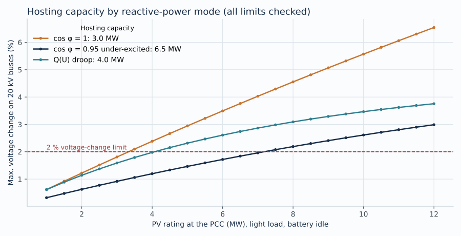

# PV + battery grid-connection study (20 kV)

A reproducible steady-state grid-connection study for a **4 MW PV plant with a 2 MW / 4 MWh battery** connected to a rural 20 kV overhead-line bus of the public **CIGRE medium-voltage benchmark network**. Built with Python and [pandapower](https://www.pandapower.org/) (October 2026).

The study answers the questions a distribution-network operator asks before a connection:

| Question | Method | Result (see `results/REPORT.md`) |
|---|---|---|
| Does the plant raise voltages too much? | Load flow over 18 cases (2 load levels × 3 PV outputs × 3 reactive-power modes); voltage change on all 20 kV buses vs. a 2 % screening limit | Unity power factor fails at full PV (2.38 % at light load); cos φ = 0.95 under-excited passes all cases (1.20 %) |
| How much PV can this bus host? | Size sweep 1–12 MW at light load, checking voltage change, ±10 % voltage band and line loading | 3.0 MW (cos φ = 1) → 4.0 MW (Q(U)) → 6.5 MW (cos φ = 0.95), where line loading becomes binding |
| Is the grid strong enough? | IEC 60909 maximum short circuit at the PCC | S″k = 97 MVA, short-circuit ratio 24 (16 incl. battery rating) |
| What does the battery add? | 96-step (15 min) time series with a 2.5 MW export cap, Q(U) active | Curtailment 7.97 → 4.18 MWh per day; PCC voltage 1.018–1.034 p.u. |



## Run

Python 3.10+.

```sh
python3 -m venv .venv && source .venv/bin/activate
pip install -r requirements.txt
python -m unittest discover -s tests -v   # 9 numerical checks
python src/run_all.py                     # regenerates results/ (about 1–2 min)
```

`results/` contains CSVs for every case, four SVG figures, `summary.json`, a generated `REPORT.md` and `manifest.json` (library versions and SHA-256 hashes of sources and outputs).

## Structure

```
src/gridstudy/network.py   CIGRE MV network + PV and battery elements at the PCC
src/gridstudy/studies.py   scenario matrix, Q(U) control loop, hosting capacity, short circuit, time series
src/gridstudy/plots.py     SVG figures
src/run_all.py             runs everything, writes results/ and REPORT.md
tests/                     power balance, Q(U) convergence, SCR, battery energy balance
docs/ASSUMPTIONS.md        plant data, limits, profiles and what the study does not cover
docs/METHOD.md             step-by-step method and interpretation of results
```

## Key findings

1. **Reactive-power mode decides connection feasibility.** At light load and full PV, unity power factor causes a 2.38 % voltage change. Absorbing reactive power at cos φ = 0.95 halves it to 1.20 %, because the overhead line has a meaningful X/R ratio.
2. **Q(U) keeps voltage in band but does not guarantee the voltage-change criterion.** At peak load the PCC voltage stays inside the Q(U) dead band, so no reactive power is absorbed and the change remains 2.62 %. A fixed cos φ is the more robust choice for the 2 % assessment; Q(U) is useful for voltage-band support.
3. **With cos φ = 0.95 the thermal limit binds before voltage.** Hosting capacity rises to 6.5 MW, where the overhead line reaches 100 % loading.
4. **The grid is strong at this bus** (SCR ≈ 24), so weak-grid converter stability is not the first concern here.
5. **A 4 MWh battery recovers about half the curtailed energy** under a 2.5 MW export cap, discharging it into the evening peak while staying within its power and energy limits.

## Scope

This is a planning-level study on a public benchmark network with assumed plant data and synthetic daily profiles. It is not a utility connection approval and does not include dynamic fault-ride-through simulation, harmonics, protection coordination or the full VDE-AR-N 4110 certification process. See [docs/ASSUMPTIONS.md](docs/ASSUMPTIONS.md).
